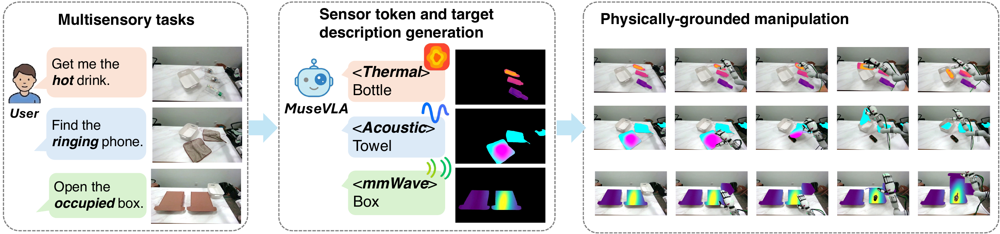
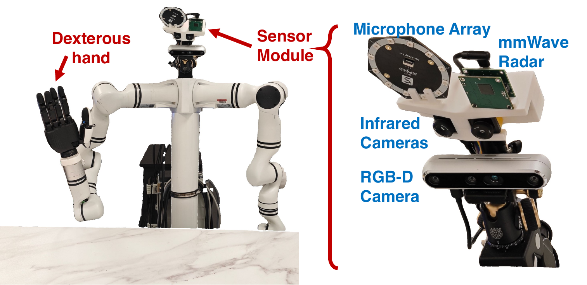

<h1 align="center">MuseVLA</h1>

<h3 align="center">An Adaptive Multimodal Sensing Vision-Language-Action Model<br>for Robotic Manipulation</h3>

<p align="center">
  <a href="https://arxiv.org/abs/2606.17598"></a>
  <a href="LICENSE.txt"></a>
  <a href="https://github.com/MuseVLA/MuseVLA"></a>
  <a href="https://huggingface.co/microsoft/MuseVLA"></a>
  <a href="https://huggingface.co/datasets/microsoft/MuseVLA-dataset"></a>
</p>

<p align="center">
  
</p>

## 🎬 Demo

https://github.com/user-attachments/assets/fde9d97a-c046-4825-bc50-06b99714e7c0

---

## 📋 Abstract

**MuseVLA** is an adaptive multimodal sensing VLA model that integrates novel sensors as on-demand tools for robotic manipulation. Built on top of [VITRA](https://github.com/microsoft/VITRA), MuseVLA enables:

- 🎯 **Adaptive Sensor Selection** — Dynamically selects from thermal, acoustic, mmWave radar, or RGB-only based on task requirements
- 🖼️ **Grounded Sensor Images** — Unified representation that overlays sensor heatmaps on RGB images
- 🔄 **Data Synthesis Pipeline** — Generates multisensory training data from existing RGB datasets

MuseVLA achieves **80.6%** success rate on average across thermal-, audio-, and radar-guided tasks, significantly outperforming RGB-only and multisensory VLA baselines.

## ✨ Features

| Feature | Description |
|---------|-------------|
| **Sensor Tokens** | `<None>`, `<thermal>`, `<radar>`, `<audio>` for adaptive sensor selection |
| **Multi-sensor Support** | Thermal camera, acoustic microphone array, mmWave radar |
| **Zero-shot Generalization** | Strong performance on unseen sensor-guided tasks (66.7% average) |

## 🛠️ Installation

### Requirements

- Python >= 3.10
- PyTorch >= 2.3.0
- CUDA >= 12.1

### Setup

```bash
# Clone the repository
git clone https://github.com/MuseVLA/MuseVLA.git --recursive
cd MuseVLA

# Create environment
conda create -n musevla python=3.10 -y
conda activate musevla

# Install dependencies
pip install -e .

# Install SAM3 submodule (required for inference)
cd third_party/sam3
pip install -e .
cd ../..
```

## 🚀 Quick Start

### Inference API Server

The pretrained MuseVLA model is available on HuggingFace at
[microsoft/MuseVLA](https://huggingface.co/microsoft/MuseVLA):

```bash
huggingface-cli download microsoft/MuseVLA --local-dir /path/to/MuseVLA
```

We provide a Flask-based inference server for easy deployment:

```bash
# Start the inference server
python scripts/inference_api_server.py \
    --vla_config musevla/configs/robot_vlm_vla_finetune_dist.json \
    --pretrained_path <CHECKPOINT_PATH>/model.ckpt \
    --statistics_path <DATA_ROOT>/statistics.json \
    --sam3_checkpoint <SAM3_PATH>/sam3.pt \
    --port 7500
```

The server exposes a REST API at `http://localhost:7500/api/inference` that accepts:
- `images`: RGB camera image (required)
- `json`: Configuration with `task_description`, `state` (18D), `cfg_scale`, `num_ddim_steps`
- `thermal_left_image`, `thermal_right_image`, `acoustic_image`, `radar_image`: Sensor images (optional)

### Inference Pipeline

The inference pipeline performs three stages:

1. **Sensor Selection** — VLM predicts which sensor to use (`<thermal>`, `<radar>`, `<audio>`, or `<None>`)
2. **Grounded Sensor Image** — SAM3 segments target object, overlays selected sensor data
3. **Action Generation** — DiT predicts action sequence from grounded sensor image + robot state

## 🔧 Hardware Setup

<p align="center">
  
</p>

MuseVLA requires an RGB camera and at least one additional sensor based on your target tasks:

| Sensor | Model | Purpose | Required For |
|--------|-------|---------|--------------|
| RGB-D Camera | Intel RealSense | Visual observation | All tasks (required) |
| Thermal Camera | infiRay T2S+ | Temperature sensing | Thermal-guided tasks |
| mmWave Radar | Calterah 4T4R 60GHz | Hidden object detection | Radar-guided tasks |
| Microphone Array | Sipeed 6+1Mic | Sound localization | Audio-guided tasks |

### Sensor Mount

We provide a 3D-printable sensor mounting platform in [`platform/base_platform.step`](platform/base_platform.step) for integrating multiple sensors with consistent alignment.

### Data Format

Sensor data should be provided as 2D heatmaps aligned with the RGB camera view:

- **Thermal**: Temperature heatmap (0-60°C range, mapped to inferno colormap)
- **Acoustic**: Sound intensity heatmap from beamforming (plasma colormap)
- **Radar**: Reflection intensity heatmap (viridis colormap)

See `calibration/` for sensor-to-RGB alignment procedures using homography matrices.

## 📦 Data Preparation

MuseVLA can be trained on three kinds of data sources. Pick whichever matches
your situation.

### Option 1: Use the Released Muse_Robot Dataset

The easiest path: download the dataset we used in the paper from HuggingFace:
[microsoft/MuseVLA-dataset](https://huggingface.co/datasets/microsoft/MuseVLA-dataset).

```bash
huggingface-cli download microsoft/MuseVLA-dataset --repo-type dataset \
    --local-dir /path/to/Muse_Robot
```

Expected layout after download:

```
Muse_Robot/
├── dataset_01/
│   ├── statistics_6dpose_delta_NRt0.json   # action normalization stats
│   ├── acoustic_data/  acoustic_labels/
│   ├── radar_data/     radar_labels/
│   └── thermal_data/   thermal_labels/
└── dataset_02/
    └── thermal_data/   thermal_labels/
```

Point `MUSE_DATA_ROOT` (or `--data_root_dir`) at `/path/to/Muse_Robot` when
training — see the [Training](#-training) section below.

### Option 2: Synthesize From Existing RGB Datasets

If you don't have multi-sensor hardware, the synthesis pipeline generates
multisensory training data from existing RGB datasets by:

1. Injecting physical property keywords into task instructions (e.g., "hot", "cold", "ringing")
2. Segmenting target objects with SAM3
3. Overlaying color-coded sensor masks on segmented regions

```bash
# Synthesize sensor-augmented data from VITRA dataset
python data/synthesis/data_synthesis_vitra.py \
    --data-root <DATA_ROOT>/VITRA_Robot_Data \
    --output-root <OUTPUT_ROOT>/VITRA_Robot_Data_Syn

# For distributed synthesis (multi-GPU)
torchrun --nproc_per_node=8 data/synthesis/data_synthesis_vitra_dist.py \
    --data-root <DATA_ROOT>/VITRA_Robot_Data \
    --output-root <OUTPUT_ROOT>/VITRA_Robot_Data_Syn
```

Synthesis scripts for other base datasets live under `data/synthesis/`:

| Script | Description |
|--------|-------------|
| `data_synthesis_vitra.py` | Synthesis for VITRA dataset |
| `data_synthesis_molmoact.py` | Synthesis for MolmoAct dataset |
| `data_synthesis_agibot.py` | Synthesis for AgiBotWorld dataset |
| `sensor_mask_utils.py` | Sensor overlay utilities |

### Option 3: Collect Your Own Multi-Sensor Data

To fine-tune MuseVLA on your own robot with real sensors, organize your data
to match the layout the merged-real-robot loader expects (same shape as the
released `Muse_Robot/dataset_01`):

```
my_robot/
├── <category>_data/                    # one or more *_data/ subfolders
│   └── <episode_name>/
│       ├── video.mp4                   # RGB video (required)
│       ├── thermal_left.mp4            # Thermal camera left  (optional)
│       ├── thermal_right.mp4           # Thermal camera right (optional)
│       ├── acoustic.mp4                # Acoustic heatmap     (optional)
│       └── radar.mp4                   # Radar heatmap        (optional)
└── <category>_labels/
    └── <episode_name>.json             # annotations: instruction, start/end frame, etc.
```

Each `*_labels/<episode_name>.json` must contain at least:

```json
{
  "frame_num_total": 240,
  "annotations": [
    {"instruction": "Pick up the hot drink.", "start": 0, "end": 239}
  ],
  "problem": {"abolished": false}
}
```

To register the dataset, add a `my_robot` branch mirroring the existing
`muse_robot` one in `musevla/datasets/materialize.py` and
`musevla/datasets/robot_dataset_vlm_vla.py`, and extend
`INSTRUCTION_SENSOR_MAP` (in `robot_dataset_vlm_vla.py`) with every
instruction string in your label files, each mapped to a
`(sensor_token, primary_object)` tuple where `sensor_token` ∈
`{"none", "thermal", "acoustic", "radar", "audio"}`. Then compute action
normalization stats by editing the dataset table at the bottom of
`musevla/datasets/calculate_statistics.py` to point at your data and running
`python -m musevla.datasets.calculate_statistics`. Finally, train with
`--data_mix my_robot --data_root_dir /path/to/my_robot_root`.

## 📚 Training

Once your data is ready (see [Data Preparation](#-data-preparation)), choose
one of the following entry points.

### Quick Start: Single-GPU Smoke Test

The fastest way to verify your environment works end-to-end:

```bash
# Either via the MUSE_DATA_ROOT env var...
export MUSE_DATA_ROOT=/path/to/Muse_Robot
bash scripts/train_local.sh

# ...or pass it explicitly on the command line:
bash scripts/train_local.sh --data_root_dir /path/to/Muse_Robot
```

`train_local.sh` uses `musevla/configs/local_train.json` (`batch_size=1`,
`max_steps=5`, `num_workers=0`, wandb disabled) so it fits on a single GPU and
finishes in a few minutes. Checkpoints land under `outputs/local_train/`.

### Full Training Run

For full multi-GPU training, edit `musevla/configs/robot_vlm_vla_finetune_dist.json`
(replace `<DATA_ROOT>` / `<WANDB_ENTITY>` / `<CHECKPOINT_PATH>` placeholders),
then:

```bash
# Single node, 8 GPUs
torchrun --nproc_per_node=8 scripts/train.py \
    --config musevla/configs/robot_vlm_vla_finetune_dist.json

# Override data root from the command line instead of editing the config:
torchrun --nproc_per_node=8 scripts/train.py \
    --config musevla/configs/robot_vlm_vla_finetune_dist.json \
    --data_root_dir /path/to/Muse_Robot
```

### Fine-tuning from a Pretrained Checkpoint

```bash
# Download pretrained model from HuggingFace
# (Link will be provided upon release)

# Fine-tune on your data
python scripts/train.py \
    --config musevla/configs/robot_vlm_vla_finetune_dist.json \
    --pretrain_path <PRETRAINED_MODEL_PATH>
```

## 📝 Citation

```bibtex
@misc{liu2026musevlaadaptivemultimodalsensing,
  title={MuseVLA: An Adaptive Multimodal Sensing Vision-Language-Action Model for Robotic Manipulation},
  author={Xingyuming Liu and Ruichun Ma and Heyu Guo and Qixiu Li and Qingwen Yang and Lin Luo and Shiqi Jiang and Chenren Xu and Jiaolong Yang and Baining Guo},
  year={2026},
  eprint={2606.17598},
  archivePrefix={arXiv},
  primaryClass={cs.RO},
  url={https://arxiv.org/abs/2606.17598},
}
```

## 📄 License

This project is licensed under the MIT License - see the [LICENSE.txt](LICENSE.txt) file for details.

## 🙏 Acknowledgments

- [VITRA](https://github.com/microsoft/VITRA) — Base VLA model for dexterous hand manipulation
- [SAM3](https://github.com/facebookresearch/sam3) — Segmentation model
- [PaliGemma](https://huggingface.co/google/paligemma2-3b-mix-224) — Vision-language backbone
